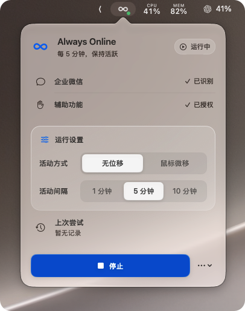
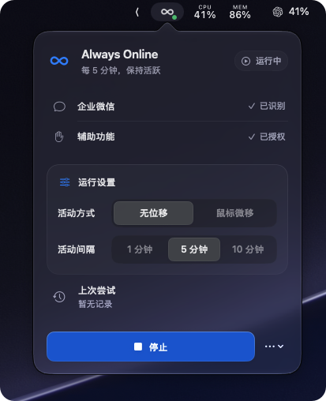

# ∞ Always Online

**Agent 在干活，别让自己先离线。**

Codex、Claude Code 正在写代码，你在看结果、查资料、思考下一步。明明人还在电脑前，企业微信却悄悄显示了「离开」。🙂

**Always Online** 是一款轻巧、优雅的 macOS 菜单栏工具，让你的工作状态少一点误会，专注不被打断。

### ✨ 小而精致

- **原生 Swift 打造** — 为 macOS 27 设计，现代、优雅，融入系统的原生体验。
- **精心打磨的 UI** — 细腻的材质、流畅的交互，每个细节都恰到好处。
- **安静且轻量** — 常驻菜单栏，不打扰、不折腾。
- **灵活的活动模式** — 无位移或鼠标微移，1 / 5 / 10 分钟自由切换。
- **状态一目了然** — 运行状态、权限检测、最近活动，清晰可见。

### 👀 看看它的样子

<table align="center">
  <tr>
    <td align="center" valign="top" width="340">
      
    </td>
    <td align="center" valign="top" width="340">
      
    </td>
  </tr>
</table>

### 🚀 下载体验

[Download for macOS →](https://github.com/DreamHeart09/AlwaysOnline/releases/download/0.1.0/Always-Online-0.1.0.dmg)

### 📦 本机生成 DMG

在 macOS 终端进入项目目录后运行：

```sh
./scripts/make-dmg.sh
```

脚本会先构建并验证 `Always Online.app`，再生成 `dist/Always-Online-0.1.0.dmg`。打开 DMG 后，将应用拖到 Applications 文件夹即可安装。应用使用本地 ad-hoc 签名，不需要 Apple Developer 账户；由于没有 Developer ID 公证，首次打开时若被 macOS 拦截，请在 Finder 中按住 Control 点击应用，选择“打开”，并在提示中确认。

原生 macOS · Swift · Open Source · MIT License

> 通过活动事件尝试维持 Mac 活跃，不保证第三方通讯软件始终显示在线。

---

<p align="center">
  <b>Stay in flow. Stay online. ∞</b>
  <br>
  <sub>如果喜欢这个小工具，欢迎点亮一颗 ⭐ Star</sub>
</p>
